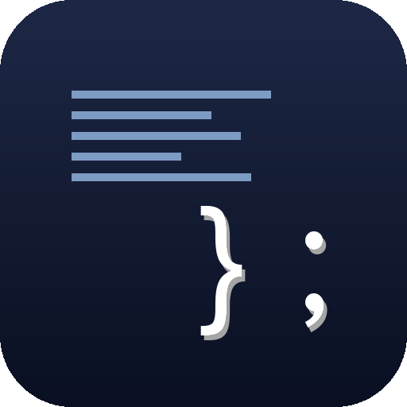

<table border="0">
  <tr>
    <td>
      <!-- VERSION -->v0.1.0<br>
      <!-- DATE -->16-Sep-2026<br>
      macOS &nbsp;|&nbsp; Windows &nbsp;|&nbsp; Linux<br>
      <a href="https://landenlabs.com">Home</a>
    </td>
    <td>
      <a href="https://landenlabs.com">
        
      </a>
    </td>
  </tr>
</table>



# py-count-java

A cross-platform CLI that counts Java "lines of code" the way
[locjava](https://sourceforge.net/p/locjava/wiki/Home/) does: a line is a
terminal semicolon or a right brace, comments are ignored, and semicolons
inside a `for (...)` header don't count. Output is a `cloc`-style
files / lines / code table.

**By [LanDen Labs](https://github.com/landenlabs) (2026)**

---

## Counting rules

- **A line of code is a terminal `;` or a `}`.** Nothing else is counted.
- **Semicolons inside a `for (...)` header are excluded** — the two
  separators in `for (int i = 0; i < 10; i++)` don't count, but a semicolon
  ending the loop body (or a single-statement body) still does.
- **Comments are ignored.** `//` line comments, `/* ... */` block comments,
  and `"""..."""` text blocks are skipped so punctuation inside them is
  never counted.
- **String and char literals are skipped too**, so a `;` or `}` inside
  `"a;b}"` or `';'` isn't mistaken for code.
- **No real parsing happens.** This is a lexical scan, not a Java grammar
  parser, so — like the original locjava — it will happily produce a count
  for invalid Java, C-like code, or plain text.

For example, this snippet has a line count of 6 (four semicolons, two
right braces):

```java
void Snoopy()
{
    int x = 0, y = 1;
    x = x + 1; y = y + 3;
    if (x == 10)
    {
        y = 0;
    }
}
```

## Usage

```bash
py-count-java.py file1.java file2.java
py-count-java.py dir1 dir2/subdir
py-count-java.py file1.java dir1 --by-file
py-count-java.py --ext java,jav src/
```

Files are counted directly regardless of extension; directories are
scanned recursively for files matching `--ext` (default `java`), skipping
hidden (dot) subdirectories.

### Options

| Flag | Purpose |
| ---- | ------- |
| `--ext EXT[,EXT...]` | Extensions to match when scanning directories (default: `java`) |
| `--by-file` | Also print a row per file, before the per-language totals |
| `--version` | Print version and exit |
| `--help` | Show full usage and examples |

### Sample output

```
------------------------------------------------------------
Language                      files      lines       code
------------------------------------------------------------
Java                              12       3456       2100
------------------------------------------------------------
```

---

## Testing

Unit tests live under `tests/` and run on the standard library `unittest`
module -- no extra dependencies. `tests/samples/` holds a handful of small
`.java` files (plus one plain `.txt` file), each hand-verified against
`wc -l` and a manual semicolon/brace tally before being hardcoded as the
expected values in `tests/test_count_java.py`:

| Sample | Exercises |
| ------ | --------- |
| `basic/Snoopy.java` | The exact example from the locjava wiki (expected count: 6) |
| `basic/ForLoop.java` | `for (...)` header semicolon exclusion, including a nested function-call paren |
| `basic/Comments.java` | `//` and `/* ... */` comments carrying decoy `;`/`}` tokens |
| `basic/Strings.java` | String/char literals and a `"""` text block, including a bare `'}'` char literal |
| `nested/Nested.java` | Recursive directory scanning (lives in a subdirectory) |
| `NotJava.txt` | Non-`.java` files are skipped during directory scans but still counted when passed explicitly |

Run the suite from the repo root:

```bash
python3 -m unittest discover -s tests -v
```

Coverage: `count_code_lines()` / `count_physical_lines()` unit checks, `find_files()`
directory-recursion / extension-filter / missing-path behavior, and two
subprocess-level CLI checks (aggregate `SUM` totals, non-zero exit on a missing path).

---

## Project structure

```
py-count-java/
├── py-count-java.py             # Main script (single-file CLI; hardcodes VERSION = "vX.Y.Z")
├── VERSION                      # Bare X.Y.Z, mirrors py-count-java.py's VERSION literal
├── set-version.bash             # Bump version, commit, tag, push (macOS/Linux)
├── set-version.ps1              # Bump version, commit, tag, push (Windows)
├── icon.png                     # App icon: baked into the release binaries, shown in README
├── icon.icns                    # App icon baked into the macOS release build
├── icon.ico                     # App icon baked into the Windows release build
├── make-icons.py                # Regenerate icon.icns/icon.ico from icon.png
├── requirements.txt
├── README.md
├── LICENSE
├── screens/                     # Images used in this README
├── tests/                       # unittest suite + sample .java files (see Testing)
└── .github/workflows/build.yml  # Tag-triggered build + GitHub Release
```

---

## Releasing

Versions are bumped with `set-version.bash` (or `set-version.ps1` on Windows), run from
the repo root:

```bash
./set-version.bash -version 0.1.1 -message "Handle Java text blocks"
```

This updates `VERSION`, the `VERSION` literal hardcoded in `py-count-java.py`, and the
version/date markers at the top of this README that feed the release build above.

---

## License

Apache 2.0 © [LanDen Labs](https://github.com/landenlabs) 2026
